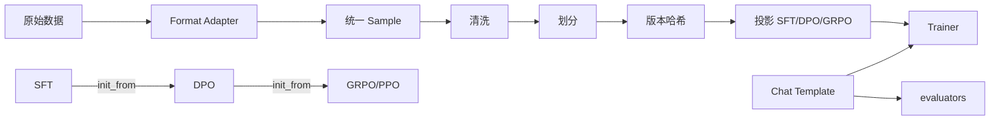

# PostTrainLab

统一的大模型后训练实验平台：SFT → DPO/IPO → GRPO，配合 Hydra 分层配置与消融实验调度。

## 硬性约定：模型只用 Qwen2.5-0.5B

**本仓库基座模型固定为 `Qwen/Qwen2.5-0.5B-Instruct`（配置见 `configs/model/qwen2.5-0.5b.yaml` / `qwen2.5-0.5b-full.yaml`）。**

- 训练、评测、消融、集成/冒烟测试 **一律只用该模型**（Full 或 LoRA 变体均可，仍是同一权重族）。
- **禁止**为省事引入 GPT-2、tiny-*、其它随机小模型或第三方基座作为替代。
- 改代码、补测试、写脚本、改文档时都要遵守；需要更小算力时用 `max_steps` / 截断长度 / LoRA，而不是换模型。

## 指标上报（MetricSink）

训练过程中的**结构化数值指标**统一经 `MetricSink`（`src/utils/metric_sink.py`）进入实验管理（当前后端为 W&B，复用 `wandb_utils`）。

| 算法 | 接入方式 |
|------|----------|
| SFT | HF `TrainerCallback.on_log` → MetricSink |
| DPO | 自研指标计算后 `metrics_fn` / Callback → MetricSink |
| GRPO | 现有 `log_fn=self.track_metrics` → MetricSink |
| PPO | 在线循环 rollout / update 关键点 → MetricSink |

要点：

- HF/TRL 的 `report_to` **固定为 `none`**，避免与 MetricSink 重复写 W&B。
- 采用「公共指标 + 算法专属指标」；不强制每算法都报 loss/KL/reward。
- `train/mean_kl`（DPO）与 `train/kl`（GRPO）定义不同，**禁止合并曲线**。
- `meta/step_kind` 标明 `optimizer_step` / `rollout_step` / `epoch` / `final`。
- 指标字典见 `src/utils/metric_catalog.py`；跨算法对比请优先看独立评测结果。
- `logger.info` 仍用于启动/加载/异常/存盘等程序事件。

## 架构

```
PostTrainLab/
├── configs/          # Hydra 分层配置（model / data / training / eval / experiment）
├── src/
│   ├── core/         # 统一基类与接口
│   ├── data/         # 统一 Sample 流水线：适配器/清洗/划分/版本/Chat Template
│   ├── models/       # 模型加载、LoRA
│   ├── algorithms/   # 自研 DPO/IPO Loss、动态 β、GRPO、SFT 采样/裁剪
│   ├── trainers/     # SFT(TRL) / DPO(TRL+自研Loss) / GRPO / PPO(TRL 基线)
│   ├── evaluators/   # 任务评测与报告
│   ├── experiment/   # 消融调度与追踪
│   └── utils/        # 通用工具
├── scripts/          # 一键训练 / 评测 / 消融
├── tests/            # 单元测试（含 DPO Loss 正确性）
├── benchmarks/       # 评测数据集
└── outputs/          # checkpoints / logs / wandb
```



## 数据流水线

一份原始数据经统一 `Sample` 后可投影到任意算法：

```bash
# 同一 gsm8k 数据 → GRPO
python scripts/train.py training=grpo data=gsm8k

# 偏好数据 → DPO
python scripts/train.py training=dpo data=dpo_demo

# 启用敏感词过滤 / 自定义划分
python scripts/train.py data.cleaning.filter_sensitive=true data.split.ratios=[0.8,0.1,0.1]
```

数据版本写入 `outputs/data_versions/<name>/<version>/dataset_version.json`，
同目录下有 `latest.json` 指针；并写入本次实验的 `cfg.data_version`。

复现实验时可强制校验：

```bash
python scripts/train.py data.expected_version=v-toy data.expected_hash=abc123def456
```

## 快速开始

### 环境

```bash
# 本地
pip install -e ".[dev]"

# 外部服务器（推荐）
bash scripts/setup_server.sh
source .venv/bin/activate
# 编辑 .env，填入 WANDB_API_KEY（从 https://wandb.ai/authorize 复制）
# 之后一般不必再执行 wandb login

# 或 Docker
docker build -t posttrainlab .
docker run --gpus all -it -v $(pwd)/outputs:/workspace/outputs posttrainlab
```

`.env.example` 可复制为 `.env`；进程启动时会自动加载（密钥勿提交 git）。

### 训练

日志、W&B、断点续训、分布式，以及梯度累积、混合精度、梯度检查点、随机种子和学习率调度都由 `BaseTrainer` 统一处理。SFT / DPO / GRPO / PPO 只实现算法。各算法 yaml 里的学习率、累积步数、调度器仍然生效；要全局覆盖时用 `engineering.*=...`。

#### SFT 基线（TRL + Full/LoRA 对比）

基于 `trl.SFTTrainer`；同一权重 `Qwen2.5-0.5B-Instruct`，用两套预设切换微调方式。自研：`sampler`（随机 / 长度分组 / 分桶）与 `grad_clip`（norm / value / adaptive）。

```bash
# LoRA
python scripts/train.py training=sft model=qwen2.5-0.5b data=gsm8k training.max_steps=20

# Full（对照）
python scripts/train.py training=sft model=qwen2.5-0.5b-full data=gsm8k training.max_steps=20

# 切换采样 / 裁剪策略
python scripts/train.py training=sft model=qwen2.5-0.5b \
  training.sampler.mode=bucket training.grad_clip.strategy=norm
```

#### DPO / IPO（TRL + 自研 Loss / 动态 β）

基于 `trl.DPOTrainer` 扩展；自研 `dpo_losses`（DPO / IPO 合页）与 `DynamicBetaController`。配置一键切换：

```bash
# 标准 DPO + 动态 β
python scripts/train.py training=dpo data=dpo_demo wandb=online

# IPO + 固定 β
python scripts/train.py training=dpo data=dpo_demo \
  training.loss_type=ipo training.beta_mode=fixed training.fixed_beta=0.1

# DPO + 固定 β
python scripts/train.py training=dpo data=dpo_demo \
  training.loss_type=dpo training.beta_mode=fixed training.fixed_beta=0.5
```

WandB 关注曲线：`train/loss`、`train/mean_kl`、`train/beta`（以及 `val/loss`、`val/mean_kl`）。

离线流水线测试（**需要 GPU**；无 CUDA 会自动 skip）：

```bash
pytest tests/test_dpo_pipeline.py -v
# 仅跑 GPU 冒烟
pytest tests/test_dpo_pipeline.py::test_dpo_pipeline_trl_train_smoke_gpu -v
```

Loss / 动态 β 纯逻辑单测（CPU 即可）：

```bash
pytest tests/test_dpo_losses.py -q
```

#### GRPO（自研完整 Rollout）与 PPO（TRL 对照）

GRPO **不调用** `trl.GRPOTrainer`。在线采样走自研 6 步管线（[`src/algorithms/rollout.py`](src/algorithms/rollout.py)）：

1. **固定档分桶 + 动态 batch**（默认 128/256/512；短档大 batch、长档小 batch）
2. 批量 `generate`（`no_grad` + `eval`；Hydra 配置 `temperature` / `top_p` / `top_k` / `num_generations`；批后清 KV）
3. 后处理：解码清洗；答案支持 `\boxed{}` 与 GSM8K `####`；过短/过长丢弃；槽位拒绝采样 + **有效不足半组时整组重采**
4. 分层奖励：正确性 + 格式 + 长度 + **逐步过程分** + **代码测例**（[`reward_functions.py`](src/algorithms/reward_functions.py)）
5. 组内相对优势归一化，组装 `input_ids` / mask / reward / advantage（另附 `prompt_ids` / `answer_ids`）
6. 指标：奖励 mean/max/min/std、合格率、tok/s、batch 耗时、峰值显存 → WandB（`rollout/*`）

随后由 [`GRPOEngine`](src/algorithms/grpo_engine.py) 做 clip + KL 更新。

PPO 与 GRPO **共用** `RewardEngine`；默认 `ppo.online_loop=true` 走 generate → 奖励 → `PPOTrainer.step`（保证 `ground_truth` / 测例元数据可用）。完整 6 步 Rollout + 组内优势仍以 GRPO 为主路径。

```bash
# GRPO 主路径（GSM8K：含 steps 逐步奖励）
python scripts/train.py training=grpo data=gsm8k training.max_steps=20

# HumanEval / 代码题（code 编译+测例奖励）
python scripts/train.py training=grpo_humaneval data=humaneval training.max_steps=20

# 关闭分桶 / 调整拒绝采样与核采样
python scripts/train.py training=grpo data=gsm8k \
  training.rollout.bucket=false training.rollout.max_resample=1 \
  training.rollout.top_p=0.9 training.rollout.top_k=50

# 消融对比时固定生成种子
python scripts/train.py training=grpo data=gsm8k \
  training.rollout.fix_generation_seed=true training.rollout.generation_seed=42

# PPO 对照基线（需环境含 TRL PPOTrainer；可接上游 DPO 权重）
python scripts/train.py training=ppo data=gsm8k training.max_steps=20 \
  engineering.init_from_checkpoint=dpo
```

#### SFT → DPO → RL 完整链路

跨阶段用 `engineering.init_from_checkpoint` **只加载权重、步数从 0 开始**（与同阶段 `resume_from_checkpoint` 续训区分）。别名 `sft` / `dpo` / `grpo` / `ppo` 指向 `outputs/checkpoints/<stage>` 下最新目录。

```bash
# 一键链路（默认 max_steps=20 冒烟；末段 rl_algorithm=grpo）
python scripts/pipeline.py
python scripts/pipeline.py pipeline.dry_run=true          # 只打印命令
python scripts/pipeline.py pipeline.rl_algorithm=ppo      # 末段改 PPO
python scripts/pipeline.py pipeline.max_steps=null        # 按各 yaml 正式训

# 或分阶段手动衔接
python scripts/train.py training=sft data=gsm8k training.max_steps=20
python scripts/train.py training=dpo data=dpo_demo \
  engineering.init_from_checkpoint=sft training.max_steps=20
python scripts/train.py training=grpo data=gsm8k \
  engineering.init_from_checkpoint=dpo training.max_steps=20
```

### 测试分层

- **CPU（轻量，无 CUDA 也应全绿）**：公式 / 奖励 / Rollout 控制流 / 数据流水线 / 策略注册等。
- **GPU（无 CUDA 自动 skip；基座仅 Qwen2.5-0.5B）**：DPO / GRPO / PPO 端到端短训冒烟。

```bash
# CPU 轻量（日常）
pytest tests/test_dpo_losses.py tests/test_grpo_loss.py tests/test_rewards.py \
  tests/test_evaluators.py tests/test_rollout.py tests/test_data_pipeline.py \
  tests/test_pipeline_offline.py tests/test_pipeline_chain.py tests/test_sft_baseline.py \
  tests/test_trainers_strategy.py tests/test_versioning.py tests/test_wandb_utils.py -q

# GPU 流水线冒烟
pytest tests/test_dpo_pipeline.py tests/test_grpo_pipeline.py tests/test_ppo_pipeline.py -v
```

#### 工程能力测试矩阵

状态含义（与「已接线」区分；当前无 GPU 服务器，故多数训练项仍非「通过」）：

| 标记 | 含义 |
|------|------|
| **通过** | GPU 端到端实测通过 |
| **CPU测** | 本机 CPU 单测/Mock 已覆盖接线与逻辑；真实训练/多卡仍 **GPU_PENDING** |
| **待验证** | 生产路径已接线，缺专项实测 |
| **部分** | 实现不完整（勿当全功能通过） |
| **未接线** | 无生产代码路径 |

| 能力 | SFT | DPO | GRPO | PPO |
|------|-----|-----|------|-----|
| BF16/FP16 | CPU测 | CPU测 | CPU测 | CPU测 |
| 梯度累积 | CPU测 | CPU测 | CPU测 | CPU测 |
| 梯度检查点 | CPU测 | CPU测 | CPU测 | CPU测 |
| LoRA | CPU测 | CPU测 | CPU测 | CPU测 |
| DDP | 待验证 | 待验证 | 待验证 | 待验证 |
| 完整断点恢复 | 待验证 | 待验证 | 部分(仅权重) | 部分(online仅权重) |
| 过程指标上报 | CPU测 | CPU测 | CPU测 | CPU测 |
| 显存监控 | 未接线 | 未接线 | 待验证 | 未接线 |

接线与完成度备注（改实现或 GPU 实测后同步改矩阵）：

- **BF16/FP16 / 梯度累积 / 梯度检查点**：`BaseTrainer.resolve_runtime` → SFT/DPO/PPO 进 HF/TRL args；GRPO 进 `GRPOEngine`（autocast + accum）；`apply_gradient_checkpointing` 统一开启。CPU：`test_trainers_strategy` 已断言配置合并与 `hf_training_kwargs`；**AMP/累积真实数值行为仍 GPU_PENDING**。
- **LoRA**：PEFT LoRA 训练与评测加载路径已实现；Checkpoint Full/LoRA 分支有 CPU Mock（`test_checkpoint_eval`）。本项目不做量化 LoRA；真实 GPU 训/评仍 **GPU_PENDING**。
- **DDP**：HF 靠 `local_rank`；GRPO 用 `prepare_native_model` 包 DDP。缺 `torchrun` 实测 → 待验证。
- **完整断点恢复**：路径解析/init_from CPU 有测；SFT/DPO 生产走 `Trainer.train(resume_from_checkpoint=…)`（DPO 另存动态 β），**完整 optimizer/step 续训未 GPU 实测**；GRPO / PPO(online) **仅恢复 adapter 权重**。
- **过程指标上报**：统一 `MetricSink` + `track_metrics`（HF `report_to` 禁直连防重复）；CPU：`test_metric_sink` / `test_wandb_utils` 已过。**真实 W&B online 曲线仍 GPU_PENDING**。
- **显存监控**：仅 GRPO Rollout 上报 `perf/peak_mem_gb`（待 GPU 勾选）；SFT/DPO/PPO **未接线**。

建议验证命令（通过后把对应格改为「通过」）：

```bash
# 混合精度 + 累积 + 检查点（单卡短训）
python scripts/train.py training=sft engineering.mixed_precision=bf16 \
  engineering.gradient_accumulation_steps=2 engineering.gradient_checkpointing=true \
  training.max_steps=4
python scripts/train.py training=dpo data=dpo_demo engineering.mixed_precision=bf16 training.max_steps=4
python scripts/train.py training=grpo data=gsm8k engineering.mixed_precision=bf16 training.max_steps=2
python scripts/train.py training=ppo data=gsm8k engineering.mixed_precision=bf16 training.max_steps=2

# 完整断点恢复（SFT/DPO：二次续训看 global_step 连续）
python scripts/train.py training=sft training.max_steps=4
python scripts/train.py training=sft engineering.resume_from_checkpoint=true training.max_steps=8

# DDP
torchrun --nproc_per_node=2 scripts/train.py training=grpo data=gsm8k training.max_steps=2
torchrun --nproc_per_node=2 scripts/train.py training=sft training.max_steps=4

# 指标 / 显存（W&B）
python scripts/train.py training=grpo data=gsm8k wandb=online training.max_steps=2
```

```bash
python scripts/train.py training=sft data=gsm8k
python scripts/train.py training=dpo data=dpo_demo
python scripts/train.py training=grpo data=gsm8k

# 开启 WandB
python scripts/train.py training=dpo wandb=online
python scripts/train.py training=grpo wandb=offline

# 从最新 checkpoint 接着训
python scripts/train.py training=sft engineering.resume_from_checkpoint=true

# 多卡
torchrun --nproc_per_node=2 scripts/train.py training=grpo data=gsm8k
```

### 日志与产物

- Hydra 每次运行目录：`outputs/logs/{algorithm}/{timestamp}/`
  - `run.log` — 控制台同级文件日志
  - `resolved_config.yaml` — 解析后的完整配置
- W&B 本地目录：`outputs/wandb/`（由 `configs/wandb/*.yaml` 控制）

```bash
# 覆盖日志级别
python scripts/train.py logging.level=DEBUG

# 自定义 run 名 / 项目
python scripts/train.py wandb=online wandb.project=my-ptl run_name=dpo-beta01
```

### 评测

统一入口：`evaluate(config, checkpoint)`（`src/evaluators/service.py`）。支持显式路径、阶段别名（`sft|dpo|grpo|ppo`）与 Full / LoRA 加载；报告为标准化 `EvaluationResult` → `eval_report.json`。

真实权重正确性为 **GPU_PENDING**；本地用 Mock 单测（`tests/test_checkpoint_eval.py`）。

```bash
# 必须指定 checkpoint（路径或阶段别名）
python scripts/eval.py eval=gsm8k data=gsm8k eval.checkpoint=sft
python scripts/eval.py eval=humaneval data=humaneval eval.checkpoint=outputs/checkpoints/sft/checkpoint-20
python scripts/eval.py eval=humaneval data=humaneval \
  eval.checkpoint=sft eval.num_samples=10 eval.k=10 eval.temperature=0.2
```

### 消融实验

`ExperimentPlanner` → `ExperimentRunner` →（可选）`ResultAggregator`。默认 **`experiment.dry_run=true`**，避免本地误启真实训练。

DPO β 消融默认：**3 个 `fixed_beta` × 3 个 seed = 9 runs**。

```bash
# 本地：只生成 plan / dry_run 状态（安全）
python scripts/ablation.py

# 已有 runs 时仅重生成报告（不训练）
python scripts/ablation.py experiment.report_only=true

# GPU：真实训练 + 自动评测 + 汇总报告
python scripts/ablation.py experiment.dry_run=false
```

产物：`outputs/ablation/<name>/` → `results.csv`、`summary.csv`、`report.md`、`plots/*.png`。

CPU 报告闭环测试：`py -3.12 -m pytest tests/test_result_aggregator.py tests/test_ablation_report_e2e.py -q`  
样例（**test_fixture**）：`python scripts/generate_cpu_ablation_fixture.py`  
GPU 验收清单见 [`docs/gpu_validation.md`](docs/gpu_validation.md)。

## 核心算法亮点

| 模块 | 说明 |
|------|------|
| `algorithms/dpo_losses.py` + `dynamic_beta.py` | 自研 DPO / IPO（公式+Config+兼容入口）+ 动态 β；`dpo_loss` / `dpo_variants` 为再导出；训练见 `trainers/dpo_trainer` |
| `algorithms/reward_functions.py` | GRPO 可插拔奖励：accuracy / format / length / **steps（逐步）** / **code（编译+测例）** |
| `algorithms/rollout.py` | GRPO 6 步 Rollout：分桶、批量生成、拒绝采样、组内组装、指标 |
| `algorithms/grpo_loss.py` + `grpo_engine.py` | 自研 GRPO：组内优势、PPO-clip、参考 KL；引擎消费 AssembledBatch |
| `trainers/ppo_trainer.py` | TRL `PPOTrainer` + 自研奖励在线循环；与 GRPO 对照消融 |
| `scripts/pipeline.py` | SFT→DPO→RL 一键链路（`init_from_checkpoint` 衔接） |
| `evaluators/` + `scripts/eval.py` | GSM8K 准确率/格式率；HumanEval 测例 pass@k |

## 实验结果

训练与评测产物统一写入 `outputs/`：

- `outputs/checkpoints/` — 模型权重
- `outputs/logs/` — 训练日志
- `outputs/wandb/` — W&B 本地缓存

（具体数值表在完成首轮实验后回填至此。）
